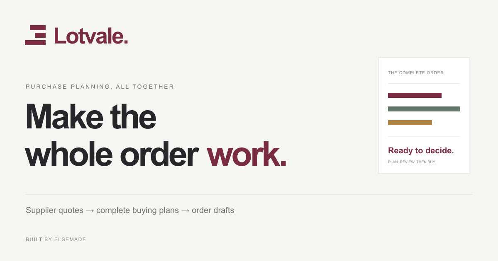

# Lotvale



**Make the whole order work.**

A cheap quote can still make a bad purchase. Pack quantities, minimum orders, freight and delivery dates change which basket you can actually buy.

Lotvale turns supplier quotes into complete buying plans and supplier-specific order drafts. It is built for small-business buyers who already have their quotes and need to make a decision.

[Watch the two-minute demo](https://lotvale.vercel.app/demo) · [Judge walkthrough](JUDGE_GUIDE.md) · [Submission write-up](SUBMISSION.md)

Live app: [lotvale.vercel.app](https://lotvale.vercel.app) — public access, no sign-in required.

## Business workspace

[Open your business workspace](https://lotvale.vercel.app/business) to create an account, set up your business and manage cloud-saved purchases. The purchase overview lists budgets, deadlines and quote review counts. Open a purchase to use the existing buying desk; **Save purchase** stores its terms and selected workflow to your account. Unsaved changes and revision conflicts remain visible. The first version supports one owner per business; team invitations and approvals are not included.

The public [sample](https://lotvale.vercel.app/app?sample=1) and browser-local editor remain available without an account. Business data never uses the sample local-storage key.

## Use it

1. Set your basket, quantities, budget and deadline.
2. Paste supplier quotes or import text/CSV files.
3. Review the extracted terms against the original text. Correct anything missing or wrong, then confirm the terms.
4. Compare complete baskets by total cost, arrival date and supplier count.
5. Choose a plan and download supplier drafts or a comparison CSV.

The public sample/local editor saves in your browser. Business purchases save to Postgres when you choose Save purchase. Export a JSON backup to move or recover a purchase. Draft orders are never sent to suppliers by the app.

## SERV Reasoning

The server calls the SERV Reasoning Chat Completions endpoint using `gpt-5.4-mini`. A provider-enforced JSON schema defines the quote contract; Zod validates the response independently. SERV matches quoted products to basket items and interprets pack prices and commercial terms. The buyer then reviews and confirms the draft.

The local planning engine evaluates item-to-supplier combinations. It performs pack rounding, applies per-item minimum packs and supplier merchandise minimums, adds freight and confirmed tax, and excludes unreviewed, expired, late or foreign-currency quotes. A comparison total is only as reliable as the entered supplier terms.

Provider documentation: [SERV API](https://docs.openserv.ai/serv-reasoning/api/chat-completions). Hackathon: [SERV Hackathon 02](https://www.openserv.ai/hackathon-2), Open Track.

## Run locally

Use Node.js 24 and npm.

```sh
npm ci
```

Create an ignored `.env.local` file at the project root:

```dotenv
SERV_API_KEY=your_key_here
DATABASE_URL=your_neon_postgres_connection_string
NEON_AUTH_BASE_URL=your_managed_neon_auth_url
NEON_AUTH_COOKIE_SECRET=at_least_32_random_characters
```

Managed Neon Auth must allow your exact local origin. The auth proxy needs the Auth URL and cookie secret even for the public sample. Run `npm run db:migrate` for business storage, then run:

```sh
npm run dev
```

Open the printed local URL. With Auth configured, the sample purchase works without a provider key; interpreting a new quote requires a valid SERV key and credits. For deployment, configure `SERV_API_KEY` as a server-side runtime secret. It must never be added to browser code.

```sh
npm run typecheck
npm test
npm run build
```

The application uses React and standard Next.js on Vercel. Public quote interpretation uses a server-only SERV key and a Vercel firewall rule allowing six requests per minute per IP. Excess requests are blocked at the edge. Production requires LOTVALE_PUBLIC_EXTRACTION=1 after that rule is configured; protected review deployments may use LOTVALE_REVIEW_MODE=1. The rate limit reduces abuse but is not a global spending cap.

## Supported commercial model

- Up to six basket items and six supplier quotes per purchase.
- One currency per purchase; no FX conversion.
- Each item's quantity is assigned to one supplier. Different items may go to different suppliers.
- Net pack prices, minimum packs, supplier merchandise minimum, freight, quote validity and delivery dates.
- A confirmed tax percentage applied to merchandise plus freight. Other tax bases and tax-inclusive quotes require manual resolution and are not automatically normalized.
- Text/CSV import and pasted text. Binary PDF import and OCR are not included; copy the text from a PDF instead.

The planner covers the modeled combinations, not every commercial negotiation. It does not verify inventory, execute payments, place orders, or prove supplier acceptance. Review current terms with suppliers before ordering.

## Evidence and data

The café sample and Harbor Paper QA quote are fictional, clearly labeled examples. The default sample's lowest complete on-time plan is $755.08; its $540.00 pack-price reference excludes commercial terms and uses a supplier that arrives late. These figures demonstrate the workflow, not real savings.

Email verification and password recovery have been exercised with delivered emails and real browser sessions; see [authentication QA](reviews/AUTH-QA.md). [Final judge rehearsal](reviews/FINAL-JUDGE-REHEARSAL.md) records the current hosted release.

Fifteen deterministic tests cover complete baskets, budget and delivery constraints, pack rounding, minimums, expired/foreign/unreviewed quotes, missing charges, invalid inputs, and exported documents. Real SERV requests and browser checks are recorded under `reviews/`; see `EVIDENCE.md` for their limits. Customer demand and willingness to pay remain untested.

## Project files

- `PRODUCT.md`: approved purpose and required capabilities.
- `BRAND.md` and `DESIGN.md`: identity and interface decisions.
- `DEMO.md`: demo architecture and truthful payoff.
- `lib/planner.ts`: deterministic purchase planning.
- `app/api/extract/route.ts`: real SERV integration and response validation.

Built by ElseMade for SERV Hackathon 02. MIT license for original project code; third-party dependencies retain their own licenses.

## Business backend setup

Use the ignored .env.local variables shown in .env.example: DATABASE_URL, NEON_AUTH_BASE_URL and a random NEON_AUTH_COOKIE_SECRET of at least 32 characters. Enable managed Neon Auth and allow the exact app origin, then run npm run db:migrate. The Next.js auth proxy owns sessions; business APIs authenticate and scope every query to the owner. Do not expose database credentials to the browser.

For integration acceptance, start the app and run npm run test:business with LOTVALE_TEST_URL set to that exact trusted origin (default http://127.0.0.1:5180). Supply two disposable, already verified QA accounts through LOTVALE_TEST_EMAIL, LOTVALE_TEST_OTHER_EMAIL and LOTVALE_TEST_PASSWORD. This checks persistence, owner isolation, stale-write protection and sign-in/out; never use customer accounts.

Production requires email ownership verification using a six-digit emailed code. Signup and unverified sign-in show the verification form; existing accounts can request a code at /auth/verify-email. Business APIs require a verified identity and validate the session with the provider. Password reset uses an emailed link, requires password confirmation, removes the token from the browser URL after success and revokes existing sessions. Saved purchases remain attached to the same account.

To run optional live email acceptance, set LOTVALE_TEST_URL and run node scripts/test-auth-email.mjs. It creates a fictional disposable mailbox using [Mail.tm](https://mail.tm), receives actual Neon emails, verifies the code, resets the password and checks session revocation and purchase recovery. No codes, passwords or reset URLs are retained. Browser evidence is recorded separately in reviews/AUTH-QA.md.

The current sender is Neon's shared auth@mail.myneon.app with the Lotvale app name. Verification and reset delivery passed with the QA mailbox; this does not establish inbox placement across all email providers. Configure a dedicated SMTP sender before a broad customer rollout, as recommended by the [Neon production checklist](https://neon.com/docs/auth/production-checklist).
